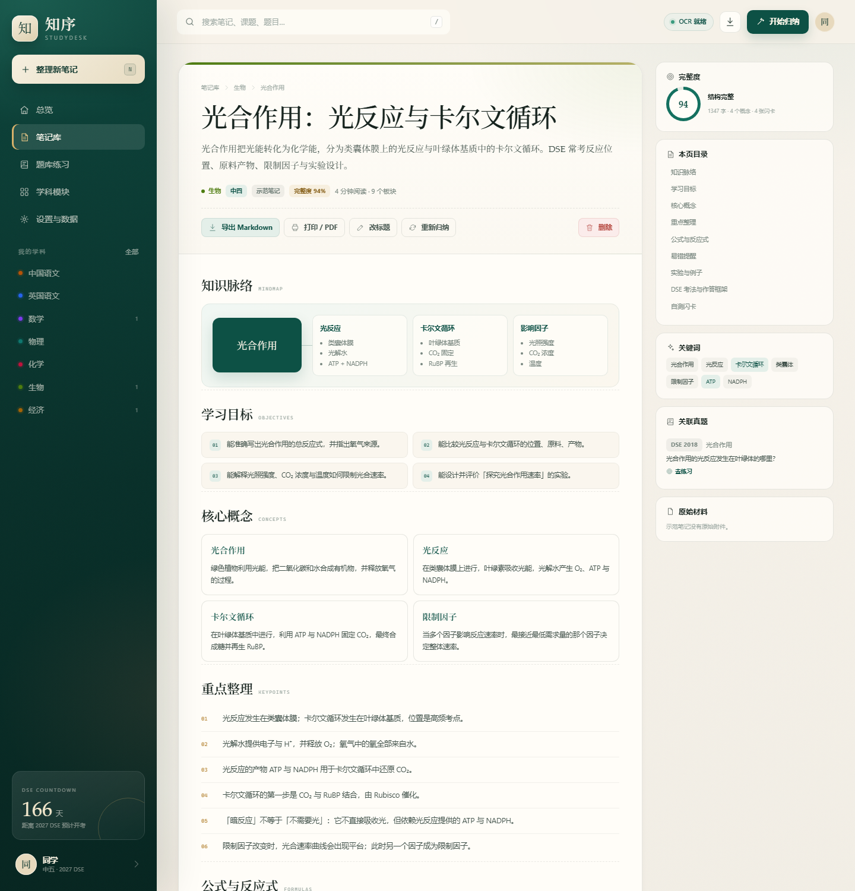
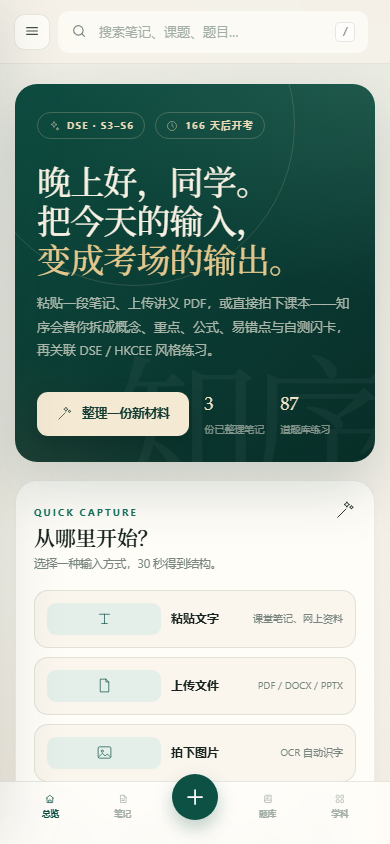
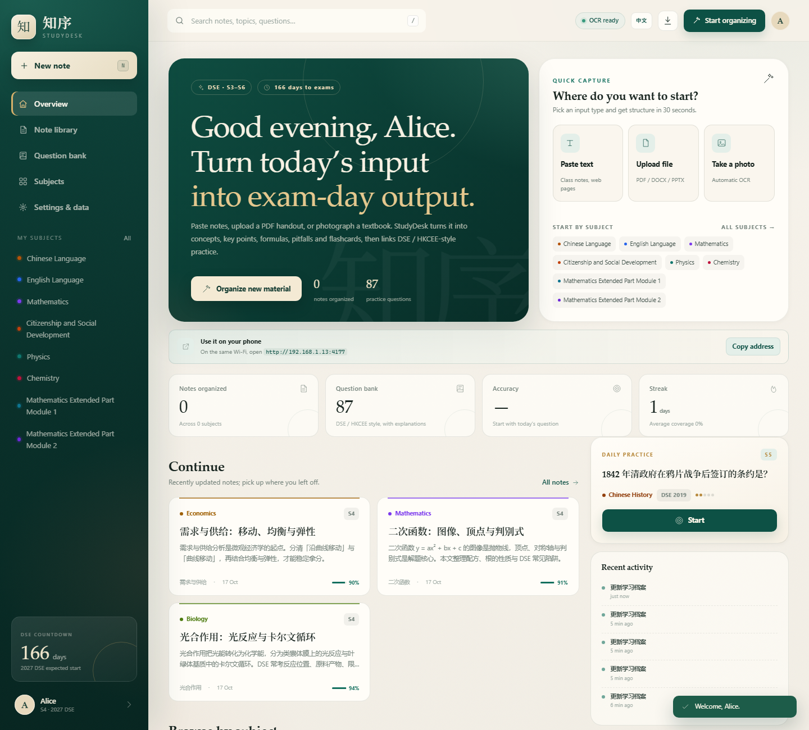
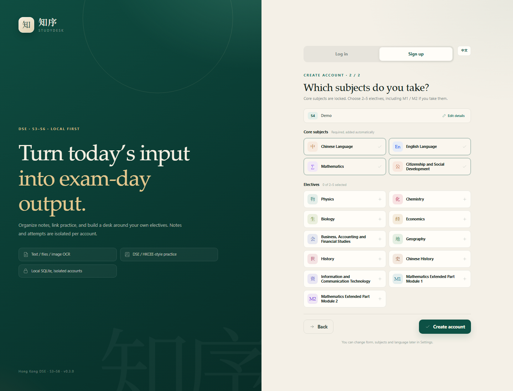

# 知序 StudyDesk

面向香港 **DSE 中三至中六（S3–S6）** 的笔记整理与知识库平台。把课堂笔记、讲义文件或课本图片交给它，自动整理成可温习的结构化笔记。

- 项目主页：<https://crzr0112.github.io/StudyDesk/>
- GitHub 仓库：<https://github.com/CRZR0112/StudyDesk>

- 可本地开发，也可 Docker + Caddy 公网部署；SQLite 与附件持久化到数据目录
- 多账号：注册 / 登录 / 退出，密码 scrypt 哈希 + HttpOnly 会话；每个账号的笔记与动态独立
- 选科：注册第二步先选科；S4–S6 核心科 + 2–5 门选修，**M1 / M2 明确在选修列表中**
- 三种输入：粘贴文字、上传文件（PDF / DOCX / PPTX / XLSX）、图片 OCR
- 学科模块化：16 个学科、174 个课题，按 S3–S6 分年级
- 输出完整学习包：知识脉络、学习目标、核心概念、重点、公式、易错点、例子、DSE 作答框架、自测闪卡
- 英文知识稿：非中文 / CSD 科目自动用本机 Ollama 转成英文；中文、CSD 保留中文
- 中英双语界面：右上角一键切换；界面与知识稿都英文，原始材料保留原文
- 可选 AI：兼容 OpenAI Chat Completions / 本地 Ollama；失败时回退本地引擎
- 客服入口：右下角微信客服，显示二维码、微信号 `Rzcr0112`，并说明在线时间不固定、24 小时内回复
- PWA：可安装到桌面，为后续 Capacitor 打包 App 留好路径


---

## 快速开始

要求 **Node.js ≥ 22.5**（需要内置 `node:sqlite`；开发与验收使用 Node 24.21）。

```bash
node server/index.mjs
```

打开 <http://127.0.0.1:4173>。首次启动会自动创建数据库、16 个学科、174 个课题与 3 份示范笔记。

第一次打开会进入登录页：先注册账号，第二步选择年级与科目（S4–S6 包括 M1 / M2），完成后才会进入自己的学习台。

系统预置 3 份**示范笔记**（生物光合作用、数学二次函数、经济需求供给），`user_id` 为空，所有账号只读可见。笔记库默认只显示「我的笔记」，示范笔记单独放在「示范笔记」标签；如果你已经有自己的笔记，总览「继续整理」不会再用示范笔记填充。

服务器会同时打印局域网地址，例如：

```text
➜  本机: http://127.0.0.1:4173
➜  局域网: http://192.168.1.13:4173  (WLAN)
```

手机 / 平板连同一个 Wi-Fi，直接打开局域网地址即可。

Windows 用户也可以直接双击项目根目录的：

- `启动知序.cmd`：自动寻找 Node 并启动服务；会提示你设置可选的访问密码（直接回车跳过）
- `打开局域网访问.cmd`：弹出 UAC，开放 TCP 4173（只需执行一次）

防火墙脚本会把规则限制在当前家庭网段（例如 `192.168.1.0/24`），换到另一个 Wi-Fi 后重新运行一次即可。这样即使电脑连过咖啡店 Wi-Fi，也不会把端口暴露给整个网络。

> 脚本还会停用 Windows 为 `node.exe` 生成的入站「阻止」规则（通常来自首次防火墙弹窗时点了取消）。Windows 中 Block 规则优先级高于 Allow；如果只加端口允许、不停用这条 Block，手机仍然会连不上。

```bash
npm test          # API 冒烟测试（独立临时数据库，不污染真实数据）
npm run dev       # node --watch，改服务端代码自动重启
npm run lan:firewall  # Windows：允许手机访问（会弹 UAC，需管理员）
```

### 环境变量

| 变量 | 默认 | 说明 |
| --- | --- | --- |
| `PORT` | `4173` | 监听端口 |
| `HOST` | `0.0.0.0` | 默认允许局域网访问；只想本机用可设 `127.0.0.1` |
| `STUDYDESK_DATA_DIR` | `./data` | 数据库、上传附件与 OCR 临时文件位置 |
| `STUDYDESK_PIN` | 空 | 可选访问密码；设置后浏览器会弹出 Basic Auth 登录框 |

```bash
# 只允许本机，不开放局域网
HOST=127.0.0.1 node server/index.mjs

# 局域网 + 访问密码
STUDYDESK_PIN=1234 node server/index.mjs
```

> Windows PowerShell 设置环境变量用 `$env:STUDYDESK_PIN="1234"`，再启动服务器。

### 局域网使用（手机 / 平板）

1. 电脑和手机连接同一个 Wi-Fi（或同一路由器网段）。
2. 启动服务器，记下控制台里的 `局域网: http://192.168.x.x:4173`。
3. 手机浏览器打开该地址即可；界面会自动适配手机。
4. 如果手机打不开，通常是 Windows 防火墙拦截。用管理员 PowerShell 执行一次：

```powershell
npm run lan:firewall
```

或在「管理员 PowerShell」中直接执行：

```powershell
New-NetFirewallRule -DisplayName "知序 StudyDesk LAN" -Direction Inbound -Protocol TCP -LocalPort 4173 -Action Allow -Profile Private,Domain,Public
```

脚本只开放 TCP 4173，不改动其他规则。家里 Wi-Fi 被 Windows 标记为「公用网络」时，仍需要这条规则；不要为了省事把整个网络防火墙关掉。

> 安全提醒：公网部署必须使用 HTTPS（Caddy/Nginx/Cloudflare Tunnel），并建议设置 `STUDYDESK_PIN`。不要直接把 4173 明文暴露到公网；SQLite 与附件要定期备份。
>
> 局域网 HTTP 下浏览器不把页面视为安全上下文，因此 PWA「安装到桌面」和剪贴板 API 可能不可用；页面与上传功能仍正常。

### 图片 OCR 说明

图片 OCR 支持两种运行环境：

- **Windows**：调用系统自带的 `Windows.Media.Ocr`（`server/scripts/ocr.ps1`），需要中文 OCR 语言包
- **Linux / Docker**：调用 `tesseract`，Docker 镜像已包含繁体中文、简体中文与英文语言包

说明：

- OCR 结果会在笔记中标注「建议对照原图校对」，专有名词、公式和标点可能有误
- 单文件上限 24 MB
- macOS 本地运行没有内置 OCR；可用 Docker 或把图片中的文字粘贴到「文字」输入框

---

## 界面

| 笔记阅读 | 手机 |
| --- | --- |
|  |  |

| 英文总览 | 注册选科（英文） |
| --- | --- |
|  |  |

---

## 账号与选科

第一次使用先注册。注册分两步：

1. 用户名、显示名称、密码、年级、目标 DSE 年份（2027–2033，可留空）
2. 选择修读科目

选科规则：

- **中三 S3**：中国语文、英国语文、数学为必修；可从综合科学、中国历史、历史、地理中保留学校有开的科目
- **中四–S6**：中国语文、英国语文、数学、公民与社会发展为核心科；选修科选 2–5 门
- 选修列表包含物理、化学、生物、经济、BAFS、地理、历史、中国历史、ICT，以及 **数学延伸部分 M1 / M2**
- 服务端会再次校验；给未选科目建笔记会被拒绝
- 之后可在「设置 → 我的选科」修改

数据隔离：

- `users` / `sessions` / `user_subjects` 保存账号、会话与选科
- 新建的笔记、上传材料、答题记录、动态都带 `user_id`
- 用户只能读取、修改、删除自己的笔记；3 份示范笔记是全局只读内容
- 密码用 Node `crypto.scrypt` 加盐哈希；会话用 HttpOnly Cookie，30 天有效
- 登录失败 5 分钟内最多 8 次（按 IP + 用户名）；同一 IP 每小时最多创建 5 个账号
- 注册成功会生成一次性显示的**恢复码**；忘记密码/用户名时用恢复码重置，旧会话立即失效
- 设置 → 账号安全可重新生成恢复码；旧恢复码随即失效
- 设置 → 账号安全 → 注销账号：输入密码并键入 `DELETE`，永久删除该账号的笔记、附件、动态与设置；示范笔记不受影响
- 密码与恢复码都只在本机校验，没有邮箱验证；如果注册后没有保存恢复码、又忘记密码，只能删除数据库里的账号后重新注册

> 恢复码格式如 `ZD-2-64303017`，包含账号定位段和随机段；请保存在密码管理器或纸上。它不是登录密码，不能单独用来登录。

### 界面语言与知识稿英文

右上角 `EN / 中文` 一键切换，登录页也可以切换。

- 语言偏好保存在用户表 `language`，下次登录沿用
- 界面导航、按钮、表单、设置、空状态等会切换
- **非中文 / CSD 科目**（生物、数学、物理、化学、经济、地理、历史、ICT、M1/M2 等）的笔记知识稿会在保存时用 Ollama 自动转成英文
- 这些科目的**课题名、单元名、学科简介**也已英文化
- **中国语文 `chi`、公民与社会发展 `csd` 保持中文**
- 题目、选项、原始 OCR 文本保留原文；需要时可自行翻译
- 支持 `?lang=en` 直接打开英文界面

> 英文化是机器翻译，专有名词、公式和语义仍建议对照原图/原文校对。当前使用 `qwen2.5:1.5b`，速度约 5–10 秒/篇；换成更大的模型（如 7B/8B）质量会更好但更慢。

---

## 功能地图

### 1. 输入与整理

- **文字**：粘贴课堂笔记、网页资料、OCR 校对后的文本
- **文件**：`.txt / .md / .csv / .json / .html / .docx / .pptx / .xlsx / .pdf`
- **图片**：`.png / .jpg / .webp / .bmp / .gif / .tiff`，Windows 或 Linux Tesseract 自动 OCR
- **元数据**：学科、年级、课题、标题；课题会自动带出对应年级
- **重组**：保存后可「重新归纳」；标题可单独修改；可导出 Markdown 或打印为 PDF

整理管线：

```text
原始材料
  → 解码 / 解压 / PDF 文字层 / Windows OCR 或 Tesseract
  → 文本清洗（保留段落与换行，只清理 OCR 逐字空格）
  → 标题识别 + 句子切分 + 学科术语加权
  → 概念定义、公式、易错句、例子抽取
  → 关键词排序、重点句打分、学习目标与闪卡生成
  → 关联同课题 DSE / HKCEE 风格题
  → 写入 SQLite（notes + sections_json + keywords_json + search_text）
```

本地引擎不调用网络，输出结构稳定；AI 只负责改写同一份 schema，不会改变前端契约。

### 2. 学科模块

| 阶段 | 学科 |
| --- | --- |
| 中三 | 中国语文、英国语文、数学、综合科学、中国历史、历史、地理 |
| 中四–中六 | 中国语文、英国语文、数学、公民与社会发展、物理、化学、生物、经济、BAFS、地理、历史、中国历史、ICT、M1、M2 |

每个学科下按年级挂载课题；每个课题独立统计笔记数与题目数。新增学科 / 课题只需扩展 `server/data/subjects.mjs`，或后续写入数据库。

### 3. 笔记库

- 标题 / 摘要 / 正文 / 关键词全文搜索（`LIKE`，中文可直接匹配）
- 按学科、年级筛选
- 阅读页：知识脉络图、概念卡、重点编号、公式块、易错提示、翻面闪卡、原始材料
- 完整度评分：根据字数、标题数、定义数、公式数、重点数估算
- 原始材料：图片可预览，文字可展开校对

### 4. 复习与自测

- 阅读页内置翻面闪卡：先回忆，再点击查看答案
- 阅读页「相关视频」：按笔记标题 + 课题 + 学科 + DSE 生成 YouTube / Khan Academy / Bing 视频搜索链接，在新标签打开
- 总览「今日复习」直接回到最近一份笔记
- 统计改为笔记数、学科覆盖、平均完整度、连续整理
- **题库练习、每日一题、答题正确率已关闭**；旧数据保留在数据库里，但不再出现在界面和导航中
- 产品定位收窄为「知识总结 + 笔记库」，不替代学校题库与 Past Papers

> **版权说明**：笔记内容由用户材料整理或由系统生成，不复制考评局官方试题；需要历年题、评卷参考与课程文件时，请使用 [HKEAA](https://www.hkeaa.edu.hk/) 或学校提供的授权资料。
### 5. 本地 Ollama / 可选 AI

当前已接入本机 Ollama：

```text
Base URL: http://127.0.0.1:11434/v1
Model:    qwen2.5:1.5b
API Key:  留空
```

实现方式：

1. 本地归纳引擎先拆出结构（标题、概念、重点、公式、易错点、闪卡）
2. 非 `chi` / `csd` 科目逐段调用 Ollama 翻译成英文
3. 中文、CSD 跳过英文化，保留中文
4. 翻译失败会重试 / 拆句 / 使用术语兜底；仍失败则保留原文并在 warnings 中提示

**费用**：Ollama 本地推理免费，只消耗电脑算力；不会产生 API 账单。图片 OCR 使用本机 Windows OCR 或服务器 Tesseract，也免费。

局域网内其他设备（手机/平板）打开网站后，调用的是**主机上的 Ollama**；手机不需要安装模型。主机休眠、关机或 Ollama 停止时，AI 英文化不可用。AI 配置是全局设置，局域网内已登录账号共用同一个本地模型。

如果改用云端 OpenAI 兼容接口：

- 费用按供应商 token 计费，一篇笔记大约几分钱到几角钱，取决于模型长度
- 在设置页替换 Base URL / 模型 / API Key 即可
- 没有 Key 时自动回退本地引擎；本机 Ollama 不需要 Key

### 6. 数据与备份

- 数据库：`data/studydesk.db`（WAL 模式）
- 附件：`data/uploads/`
- 设置页可一键导出**当前账号**的 JSON 备份（学科、课题、自己的笔记、题目、答题记录、选科）
- 换设备时复制 `data/` 即可；未来 App 可复用同一套 API 与 schema

---

## 技术架构

```text
public/                    原生 ES Modules + CSS，无构建步骤
  index.html
  app.js                   hash 路由 / 页面渲染 / 交互 / 登录注册 / 语言切换
  i18n.js                  中文模板 + 英文词典 + DOM 翻译
  styles.css               设计系统与响应式
  manifest.webmanifest
  sw.js                    离线 shell（API 不走缓存）
  icons/
server/
  index.mjs                HTTP 服务、静态资源、安全头、优雅退出
  api.mjs                  REST API、输入校验、文件服务、权限隔离
  auth.mjs                 scrypt 密码、会话、选科校验
  db.mjs                   SQLite 连接、迁移、种子、统计
  engine.mjs               本地归纳引擎（无外部依赖）
  extract.mjs              TXT/MD/DOCX/PPTX/XLSX/PDF 提取
  ocr.mjs + scripts/ocr.ps1  Windows OCR / Linux Tesseract 桥
  network.mjs              局域网地址探测
  ai.mjs                   OpenAI 兼容 AI 增强与回退
  translate.mjs            Ollama / OpenAI 逐段英文化
  data/                    学科、题库、示范笔记种子
scripts/open-lan-firewall.ps1  开放 TCP 4173 的 Windows 防火墙规则
test/smoke.mjs             独立临时数据库的 8 项账号 / API 测试
data/                      运行时生成，不提交
```

### 数据库

| 表 | 作用 |
| --- | --- |
| `users` | 账号、显示名称、密码哈希、年级、目标、语言 |
| `sessions` | 登录会话（token 哈希、过期时间、最后活动） |
| `user_subjects` | 每个账号的核心科 / 选修科与排序 |
| `subjects` | 学科模块（code 稳定标识、颜色、阶段、官方链接） |
| `topics` | 课题（学科外键、年级、单元、排序） |
| `sources` | 原始输入（归属用户、文字、文件名、MIME、附件路径、OCR 标记） |
| `notes` | 整理结果（归属用户、summary、`sections_json`、`keywords_json`、engine、coverage） |
| `questions` | 题库（来源、年份、试卷、难度、选项、答案、解释、标签） |
| `resources` | 外接题库链接（全局示范或用户自己添加） |
| `attempts` | 答题记录（归属用户、响应、对错、自评） |
| `activity` | 动态流（归属用户、整理、修改、删除） |
| `settings` | 全局 AI 配置、外观 |
| `schema_migrations` | 版本化迁移 |

设计要点：

- **账号隔离**：`notes` / `sources` / `attempts` / `activity` 都带 `user_id`；`user_id IS NULL` 的 3 份笔记是全局只读示范
- **选科驱动**：`user_subjects` 决定侧边栏、整理页与题库默认范围；服务端拒绝未选科目
- **JSON 章节**：`sections_json` 让笔记板块可以随迭代增删（新增 `timeline`、`comparison` 等类型不需要改表）
- **稳定 code**：学科 / 课题 code 作为外部引用，数据库自增 id 仅内部使用
- **可追溯**：`sources.text_content` 保存提取后的原文，支持重新归纳
- **迁移而非重建**：`server/db.mjs` 的 `MIGRATIONS` 按版本执行；新增字段请追加迁移
- **SQLite 单文件**：方便备份、迁移和容器持久化

### API 摘要

| 方法 | 路径 | 说明 |
| --- | --- | --- |
| GET | `/api/health` | 版本、OCR / AI 可用性 |
| GET | `/api/catalog` | 公开学科目录；注册页选科用，含核心/选修与 M1/M2 |
| POST | `/api/auth/register` | 注册；用户名、密码、年级、选科 |
| POST | `/api/auth/login` | 登录，下发 HttpOnly 会话 Cookie |
| POST | `/api/auth/recover` | 用恢复码重置密码并返回用户名 + 新恢复码 |
| POST | `/api/auth/recovery-code` | 登录状态下用当前密码生成新恢复码 |
| DELETE | `/api/auth/account` | 注销账号；需要密码 + `confirm: "DELETE"` |
| GET | `/api/auth/me` | 当前账号与选科 |
| POST | `/api/auth/logout` | 退出并清除会话 |
| GET | `/api/bootstrap` | 当前账号的学科树、统计、动态、设置、官方资源 |
| GET | `/api/notes` | 我的 + 示范；`scope=mine/samples/all`、`subject` `form` `topic` `q` |
| POST | `/api/notes` | 创建；`text` 或 `file.data`（base64） |
| GET | `/api/notes/:id` | 详情 + 关联题 + 同科笔记 + 原始材料 |
| PATCH | `/api/notes/:id` | 改标题 / 摘要 / 章节 / 关键词（仅自己的笔记） |
| DELETE | `/api/notes/:id` | 删除自己的笔记与无引用附件 |
| GET | `/api/notes/:id/export.md` | Markdown 下载 |
| POST | `/api/notes/:id/regenerate` | 用原始文本重新归纳（仅自己的笔记） |
| GET | `/api/questions` | 题库；默认 `scope=mine` 只返回已选科目，`scope=all` 全部；`subject` `topic` `form` `origin` `year` `difficulty` `q` |
| GET | `/api/questions/daily` | 每日一题，只从已选科目抽取 |
| GET / POST | `/api/resources` | 外接题库资源列表 / 添加自己的链接 |
| DELETE | `/api/resources/:id` | 删除自己添加的外接题库链接 |
| POST | `/api/attempts` | 记录一次作答（归属当前账号） |
| GET | `/api/search?q=` | 搜自己的笔记 + 示范笔记 + 已选科目题目 |
| GET / PUT | `/api/settings` | 档案、选科、语言、AI 配置（Key 掩码） |
| POST | `/api/settings/ai-test` | 测试模型连接 |
| GET | `/api/export` | 当前账号的 JSON 备份 |
| GET | `/api/files/:sourceId` | 附件原文件（仅自己的） |

所有写操作检查 `Origin`，只接受同源或本机来源。服务默认监听 `0.0.0.0` 以支持家庭局域网；如不需要手机访问，建议设 `HOST=127.0.0.1`，并配合 `STUDYDESK_PIN` 使用。

---

## 公网服务器部署

这是一个**服务端应用**：用户打开网址、注册/登录即可使用，不需要每人安装 Node 或配置本地环境。

推荐 Docker + Caddy：

```bash
cp deploy/.env.example .env
# 编辑 .env：DOMAIN、STUDYDESK_PUBLIC_URL
docker compose up -d --build
```

Caddy 会自动为域名申请 HTTPS 证书，并把请求反代到应用。

### 需要准备

- 一台有公网 IP 的 Linux 服务器（2 GB 内存起）
- 域名 A/AAAA 记录指向服务器
- Docker + Docker Compose
- 开放 80 / 443

### 配置项

| 变量 | 说明 |
|---|---|
| `STUDYDESK_PUBLIC_URL` | 公网 HTTPS 地址，例如 `https://study.example.com` |
| `STUDYDESK_TRUST_PROXY=1` | Docker/Caddy 反代时开启，允许读取 `X-Forwarded-Host` |
| `STUDYDESK_PIN` | 可选的额外入口密码；公开服务建议设置 |
| `STUDYDESK_DATA_DIR` | SQLite 与附件目录；Docker 中固定为 `/app/data` |

### 数据

- 笔记、账号、附件都在 Docker volume `studydesk-data`
- 部署前请确认备份策略；不要只依赖容器内文件
- `.env`、`data/`、`internal/` 不应提交到 Git

### AI

- 应用通过设置页配置 OpenAI 兼容接口
- 本机 Ollama 只适合小规模；公开服务建议专用模型服务或限流
- 容器访问宿主机 Ollama 时，Windows/Mac 通常用 `http://host.docker.internal:11434/v1`

详见 [deploy/README.md](deploy/README.md)。

---

## GitHub Pages 项目主页

已上线：<https://crzr0112.github.io/StudyDesk/>

当前 Pages 配置：`main` 分支 / `/docs` 目录。`docs/` 下是可直接托管的静态项目介绍页：

- `docs/index.html`：产品介绍、功能、截图、隐私说明、FAQ、微信客服
- `docs/styles.css`：页面样式，无外部字体/CDN 依赖
- `docs/assets/`：压缩后的截图、社交预览图、微信二维码
- `docs/.nojekyll`：关闭 Jekyll，保证静态资源正常访问

发布步骤：

1. 把项目推到 GitHub 仓库
2. 打开仓库 **Settings → Pages**
3. **Build and deployment → Source** 选 `Deploy from a branch`
4. Branch 选 `main`，目录选 `/docs`，保存
5. 等 1–2 分钟，访问 `https://<你的用户名>.github.io/<仓库名>/`

如果不用命令行：安装 GitHub Desktop → Add local repository → Publish repository，然后在 GitHub 网页做第 2–4 步。`data/`、`internal/`、`tmp/` 已在 `.gitignore` 中，不会上传。

> GitHub Pages 只放介绍页，不运行 Node/SQLite/Ollama；实际应用运行在 Docker/Caddy 服务器上。`internal/business-plan.md` 是内部商业规划，不放在公开页面。

---

## 测试与验收

```bash
npm test
```

覆盖：登录保护、注册与选科（含 M1）、示范笔记、未选科目拦截、文字整理、搜索、Markdown、标题修改、答题统计、第二个账号的数据隔离、语言偏好、备份、登出与删除。

本次开发另用 Playwright + Edge 实测了：

- 注册两步表单：S4 核心科 + 选修科，M1 / M2 出现在列表中
- 登录 → 总览 → 设置 → 退出 → 再登录
- 中英文一键切换；英文注册、英文总览、英文设置
- 1440px 桌面与 390px 手机布局
- 粘贴文字 → 进度浮层 → 笔记详情（9 个板块、公式识别）
- 题库 → 选项 → 查看答案 → 答案解析
- 图片 OCR、DOCX / PDF 提取

---

## 已知限制

- OCR 依赖 Windows；其他平台需手动粘贴图片文字
- PDF 只提取文字层；扫描件请截图后走 OCR，复杂公式排版会丢失
- 搜索按字面匹配，暂未做简繁转换；建议用材料中的写法搜索
- 本地引擎是规则 + 词典 + 统计的抽取式整理，不会像大模型一样重写论证；适合作为可靠底稿，再手动润色
- 账号是本地账号：没有邮箱验证、管理员后台；忘记密码/用户名需要用注册/设置时生成的恢复码
- 如果没有保存恢复码且忘记密码，无法自助找回；需要直接操作数据库或重新注册
- 语言切换会切换界面；非中文 / CSD 科目的知识稿由 Ollama 转成英文，中文 / CSD 保留中文
- 英文翻译为机器翻译，专有名词与语义需要校对；当前 1.5B 模型质量有限
- 默认允许局域网访问，建议设置 `STUDYDESK_PIN`；不要把端口直接暴露到公网
- 题库模块已关闭，旧数据保留但不再展示；当前产品只做知识总结与笔记库

---

## 迭代方向

| 版本 | 内容 |
| --- | --- |
| v0.1 | 本地整理、学科模块、笔记阅读、OCR、PWA、JSON 备份 |
| v0.2 | 家庭局域网访问、可选 `STUDYDESK_PIN` 访问密码、Windows 防火墙脚本 |
| v0.3 | 多账号注册登录、数据隔离、选科（含 M1/M2）、中英文界面一键切换 |
| v0.3.1 | 修复 OCR 乱码标题、示范笔记与个人笔记分离、英文 TOC / 统计单位细节 |
| v0.3.2 | 关闭题库 / 每日一题 / 答题统计，收窄为纯知识总结与笔记库 |
| v0.3.3 | DSE 目标年份选择、动态倒数、账号注销、恢复码找回、注册频率限制、英文课题元数据、相关视频 |
| v0.4.0（当前） | 公网 Docker/Caddy 部署、HTTPS 反向代理适配、Secure Cookie、远程入口设置 |
| v0.5 | 间隔重复排程、云同步、闪卡复习清单、薄弱课题提示 |
| v0.6 | 多设备共享、教师共享学科包、协作批注 |
| v1.0 | Capacitor 打包 iOS / Android；复用同一 API 与 SQLite schema |

「做成 App」的路径已经预留：前端是 PWA（可安装、离线 shell），API 与数据层独立，移动端只需套壳或复用 REST 接口。

---

## 免责声明

本项目用于个人学习与笔记整理。DSE 为香港考试及评核局举办之考试。历年试题、评卷参考与课程文件请以 [HKEAA](https://www.hkeaa.edu.hk/) 与 [EDB](https://www.edb.gov.hk/) 官方发布为准。
