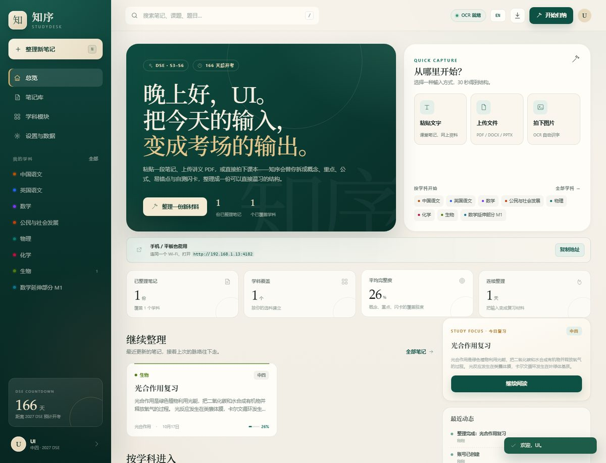

# Zhixu StudyDesk

**An English-first note organizer for Hong Kong DSE S3–S6 students.**

Zhixu turns photos, PDFs, handouts and class notes into structured study notes: a knowledge map, key points, formulas, common mistakes, examples, answer frames and revision flashcards. It is a note desk, not a question bank.

[Live app](https://64-188-27-218.sslip.io) · [Project page](https://crzr0112.github.io/StudyDesk/) · [Chinese page](https://crzr0112.github.io/StudyDesk/zh/) · [GitHub](https://github.com/CRZR0112/StudyDesk)



> The public app currently runs on a temporary `sslip.io` HTTPS domain. For production, point your own domain at the server and update `STUDYDESK_PUBLIC_URL`.

## Features

- **Three input types**: paste text, upload files (`.pdf`, `.docx`, `.pptx`, `.xlsx`, `.txt`, `.md`, `.csv`, `.json`), or upload an image for OCR.
- **DSE-specific structure**: 16 subjects and 174 topics, organized by S3–S6, core subjects and electives (including M1 / M2).
- **Structured output**: knowledge map, learning objectives, core concepts, key points, formulas, pitfalls, examples, answer frames and flip cards.
- **Account isolation**: registration, sign-in, sessions, per-user notes, attachments and subject choices.
- **English interface by default**: one English product surface for demos and public use.
- **Related video search**: YouTube, Khan Academy and Bing links generated from the note title, topic and subject.
- **Export and deletion**: JSON backup, Markdown export and permanent account deletion.
- **Server deployment**: Docker + Caddy, automatic HTTPS, persistent SQLite and uploads.
- **Optional AI**: bring an OpenAI-compatible endpoint; the app works without it.

## Status

| Item | Current state |
|---|---|
| Version | v0.4.0 |
| Account smoke tests | 8 / 8 passing |
| OCR | Windows system OCR; Linux/Docker Tesseract (Traditional Chinese, Simplified Chinese, English) |
| AI | Optional; `ai:false` on the 2 GB public server |
| Storage | SQLite + local uploads |
| Public demo | Temporary `64-188-27-218.sslip.io` domain |

## Quick start

Requirements: **Node.js 24+** (node:sqlite is used). There are no npm runtime dependencies.

```bash
npm start
```

Open:

```text
http://127.0.0.1:4173
```

For development:

```bash
npm run dev
```

## Public server deployment

### One-command installer (Debian 12)

On a fresh Debian 12 server as root:

```bash
curl -fsSL https://raw.githubusercontent.com/CRZR0112/StudyDesk/main/deploy/install.sh | bash
```

The installer:

- installs Docker
- clones the project to `/opt/studydesk`
- opens ports 80 / 443
- starts the app behind Caddy with automatic HTTPS
- uses `<server-ip>.sslip.io` by default

Use your own domain instead:

```bash
curl -fsSL https://raw.githubusercontent.com/CRZR0112/StudyDesk/main/deploy/install.sh | bash -s -- study.example.com
```

Point the domain's A/AAAA record at the server before running the installer.

### Manual Docker deployment

```bash
cp deploy/.env.example .env
# edit DOMAIN and STUDYDESK_PUBLIC_URL
docker compose up -d --build
docker compose logs -f caddy
```

Then open `https://your-domain`.

See [deploy/README.md](deploy/README.md) for details.

## Configuration

| Variable | Default | Purpose |
|---|---|---|
| `HOST` | `0.0.0.0` | Bind address |
| `PORT` | `4173` | HTTP port |
| `STUDYDESK_DATA_DIR` | `./data` | SQLite database, uploads and OCR temp files |
| `STUDYDESK_PUBLIC_URL` | empty | Public HTTPS origin, e.g. `https://study.example.com` |
| `STUDYDESK_TRUST_PROXY` | off | Set to `1` behind a trusted reverse proxy |
| `STUDYDESK_PIN` | empty | Optional HTTP Basic Auth password |

Production example:

```bash
STUDYDESK_PUBLIC_URL=https://study.example.com
STUDYDESK_TRUST_PROXY=1
STUDYDESK_PIN=change-me
```

## OCR

### Windows

Uses `Windows.Media.Ocr` through `server/scripts/ocr.ps1`.

- Windows 10/11 works out of the box when the Chinese OCR language pack is installed.
- OCR results are marked for proofreading against the original image.

### Linux / Docker

The Docker image installs Tesseract with:

- `chi_tra` (Traditional Chinese)
- `chi_sim` (Simplified Chinese)
- `eng` (English)

Images are processed by the server and can be corrected in the note editor. The API health endpoint reports OCR availability:

```bash
curl https://your-domain/api/health
```

```json
{ "ocr": true }
```

## Accounts and data

- Passwords use scrypt hashing.
- Sessions use HttpOnly cookies; HTTPS adds `Secure`.
- Registration is rate-limited per IP; login and recovery attempts are rate-limited.
- Notes, attachments, activity and subject choices are scoped by `user_id`.
- Sign out, recovery-code reset and permanent account deletion are supported.
- JSON backup and Markdown export are available from Settings.

## Tech stack

```text
Browser (desktop / mobile / PWA)
  -> Caddy or reverse proxy (HTTPS)
  -> Node.js HTTP server (0.0.0.0:4173)
  -> SQLite (node:sqlite)
  -> local uploads
  -> OCR (Windows system OCR or Linux Tesseract)
  -> optional OpenAI-compatible API
```

- Node.js 24, `node:sqlite`, WAL mode, schema migrations
- Vanilla ES modules, no frontend build step
- Vanilla CSS, responsive layout
- PWA manifest and service worker
- Docker + Caddy deployment
- No external database or queue required

## Project layout

```text
server/
  index.mjs        HTTP server, static files and route dispatch
  api.mjs          authentication, notes, uploads, settings and export APIs
  auth.mjs         password hashing, sessions and account helpers
  db.mjs           SQLite schema, migrations and seed data
  engine.mjs       note-structuring engine
  extract.mjs      PDF / DOCX / PPTX / XLSX / text extraction
  ocr.mjs          Windows OCR / Linux Tesseract bridge
  ai.mjs           optional OpenAI-compatible client
  translate.mjs    optional translation layer
  data/            subjects, topics, sample notes and questions
public/
  index.html       application shell
  app.js           client application
  i18n.js          interface translations
  styles.css       application styles
  sw.js            service worker
docs/
  index.html       English landing page (default)
  en/index.html    English landing page
  zh/index.html    Chinese landing page
  assets/          screenshots and social image
deploy/
  install.sh       Debian one-command installer
  Caddyfile        HTTPS reverse proxy
  README.md        deployment details
test/
  smoke.mjs        account and API smoke tests
```

## API overview

All application routes require a session unless marked public.

| Method | Route | Purpose |
|---|---|---|
| `GET` | `/api/health` | Version, OCR and AI availability |
| `GET` | `/api/catalog` | Public subject catalog |
| `POST` | `/api/auth/register` | Create account |
| `POST` | `/api/auth/login` | Sign in |
| `POST` | `/api/auth/logout` | Sign out |
| `GET` | `/api/auth/me` | Current user |
| `POST` | `/api/auth/recover` | Reset with recovery code |
| `POST` | `/api/auth/recovery-code` | Generate a new recovery code |
| `DELETE` | `/api/auth/account` | Permanently delete the account |
| `GET` | `/api/bootstrap` | App state, profile, subjects and recent notes |
| `GET` | `/api/notes` | List notes |
| `POST` | `/api/notes` | Create a note from text or an uploaded source |
| `GET` | `/api/notes/:id` | Read a note |
| `PATCH` | `/api/notes/:id` | Edit title, topic or content |
| `DELETE` | `/api/notes/:id` | Delete a note |
| `GET` | `/api/search?q=` | Search notes |
| `GET` | `/api/settings` | Read settings |
| `PUT` | `/api/settings` | Update profile, subjects or AI settings |
| `GET` | `/api/export` | JSON backup |
| `GET` | `/api/export/markdown` | Markdown export |

## Tests

```bash
npm test
```

The smoke suite covers:

- health, catalog and login protection
- registration with core subjects and electives
- account isolation and subject restrictions
- note creation, search, export and editing
- logout, expired sessions and account deletion

Current result: **8 / 8 passing**.

## Roadmap

- Spaced-repetition scheduling and a review queue
- Cloud sync and multi-device accounts
- Teacher / tutor shared subject packs
- Classroom-friendly onboarding and analytics
- Payment and school licensing (when there is validated demand)
- Mobile packaging through Capacitor

## Design principles

- **Notes, not a question bank** — the product focuses on organizing the student's own material.
- **English-first public surface** — clear for international judges, schools and partners.
- **Server-hosted, account-based** — users open a URL; they do not install Node or configure a local machine.
- **Graceful degradation** — OCR and the local organizer work without AI; AI is optional.
- **Small operational footprint** — one Node process, SQLite and a reverse proxy.

## Security notes

- Always use HTTPS in public deployments.
- Set a strong `STUDYDESK_PIN` if the service is not invite-only.
- Keep `.env`, `data/` and `internal/` out of Git.
- Back up the Docker volume or `data/` directory regularly.
- Rotate root, control-panel and API credentials after sharing them during setup.
- Do not expose port 4173 directly to the internet without a reverse proxy.

## Disclaimer

Zhixu StudyDesk is an independent student project. It is not affiliated with the Hong Kong Examinations and Assessment Authority (HKEAA), the Education Bureau, or any school. DSE is an examination administered by HKEAA. Always use authorised source material for official past papers, marking schemes and curriculum documents.

## License

This repository is currently a private project. No license is granted for redistribution or commercial use without permission.
